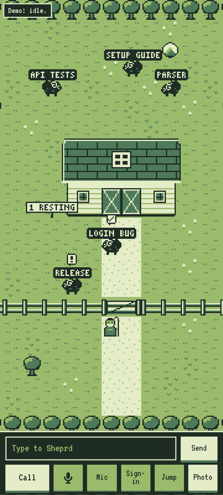

# Sheprd

Call your Herdr coding agents from your phone and talk to them, with a self-hosted voice and a retro screen that shows the herd.

## What it is

Coding agents keep working in terminal tabs after you walk away from the keyboard. Sheprd lets you check on them and
give them work by voice from a phone: you talk to one Claude Code session (the desk) in a Herdr tab, and it reads,
steers and starts the others. It is a working prototype used daily by one person; expect rough edges.



## Features

- Talk to a live Claude Code session in a Herdr tab, or type to it in that tab: both reach the same conversation,
  and one session lasts the day.
- Self-hosted speech, no cloud speech API: faster-whisper with your own word list, Kokoro for the voice, Silero VAD
  and Smart Turn for turn-taking. You can cut in at any time, and the desk drops what you did not hear unless you ask for it.
- The herd on screen: every other agent in the Herdr workspace is a sheep showing Herdr's status (working in the
  field, blocked at the gate, done by the barn doors, idle resting beside the barn). Tap one for a recap, or talk to
  it directly.
- The conversation is a thread of handheld-RPG text boxes under the pasture: what the desk says, what you typed,
  what the call heard you say. Scroll back any time; it stays through games and across calls, and leaving and
  reopening the app brings back the thread, the open card, the open sheep and a half-typed line (localStorage).
- Tap the speaking reply or its portrait to reveal all its received text while speech keeps playing. Later sentences
  in that reply appear immediately; the next reply uses the usual pacing. The corner portrait reopens a hidden thread.
- Cut in and the reply stays whole in the thread: the words you heard, then the rest dimmed behind a NOT SPOKEN tag,
  so you can scroll back and read what the voice never said. Speech still stops where you cut in.
- Cards instead of reading aloud: the desk puts links, codes, commands, images and audio clips on the phone screen
  with `[show]...[/show]` (`call-show <file>` prints the marker); a clip plays on the screen with the mic held.
- Almost no buttons: the Shepherd in the yard is the call (the page calls when it opens; tap him to call again, twice
  to hang up), the picture box by the yard adds a photo or video, a "!" over him is a sign-in waiting. Mute is the
  key beside the mic meter at the top right; Send sits right of the type box. Everything has a keyboard and
  screen-reader mirror.
- A loading screen while the call connects or reconnects: an ASCII night pasture that decrypts into place, then
  idles (stars twinkle, sheep blink); a tap skips it, and reduced motion keeps it still.
- Eleven optional one-button games above the thread, each a drop-in module. Tap the PLAY sign to open one and
  Close game to return to the world; thinking never opens a game for you.
- Photos and videos from the phone go to the desk as frames plus an audio transcript.
- A login, CAPTCHA or 2FA page a tool is waiting on opens on the call screen, so you never leave the call.

## Tech stack

- **Languages**: Python, JavaScript
- **Voice**: Pipecat 1.15 over WebRTC, faster-whisper (large-v3-turbo), Kokoro, Silero VAD, Smart Turn v3
- **Web**: one HTML page, Phaser 4.2.1 (vendored), bundled pixel fonts, no CDN at runtime
- **Agents**: Herdr, Claude Code
- **Infra**: systemd user units, Tailscale

## Getting started

These steps run everything on one machine.

### Prerequisites

- Linux with systemd
- Python 3.11+ (tested on 3.12)
- [Herdr](https://herdr.dev) 0.9+ and Claude Code, signed in
- ffmpeg and ffprobe (photos and videos)
- An NVIDIA GPU is optional: Whisper falls back to CPU int8 without one
- Tailscale on the machine and the phone: the phone's microphone needs HTTPS, which `tailscale serve` provides

### Install

```bash
git clone <this repo's URL> ~/sheprd-call
cd ~/sheprd-call
python3 -m venv .venv
.venv/bin/pip install -r requirements.lock
```

### Configure

```bash
mkdir -p ~/.config/shepherd
cp shepherd.env.example ~/.config/shepherd/shepherd.env
```

Every value in the file is the default, so it runs as is. The ones you are most likely to change:

- `VOICE_WORKDIR`: the folder the desk works in (default your home).
- `VOICE_DESK_ADDENDUM`: a file of your own rules appended to the desk's prompt
  (default `~/.config/shepherd/desk-addendum.md`).
- `VOICE_STT_VOCAB`: your project, people and machine names, so speech recognition spells them right
  (format in `stt_eval.py`).
- Voice on another machine: set `VOICE_SESSION_HOST` and `VOICE_ALLOWED` on the bridge, and `VOICE_SESSION_URL` on
  the voice host.

### Run

```bash
cp deploy/shepherd-bridge.service deploy/shepherd-voice.service ~/.config/systemd/user/
systemctl --user daemon-reload
systemctl --user enable --now shepherd-bridge shepherd-voice
sudo tailscale serve --bg --https=8443 http://127.0.0.1:7862
```

Open `https://<machine>.<tailnet>.ts.net:8443/call` on the phone to start the call. The phone app's `/call?view` entry
opens `call?auto` in its call screen, which owns microphone permission. `/call?view&plain` keeps a read-only screen;
`/call?view&demo` shows a made-up herd without a microphone. `python3 -I bridge.py --check` runs the bridge's self-test.

## How it works

```
phone: call page (HTTPS through tailscale serve)
  |  WebRTC audio + data channel
  v
voice: bot.py (Pipecat)   Silero VAD -> Smart Turn -> faster-whisper -> turn ... reply -> Kokoro
  |  POST /turn, GET /events (NDJSON)
  v
bridge: bridge.py   types each turn into the desk, tails its transcript, watches the herd
  |  herdr CLI
  v
Herdr: the `desk` tab (Claude Code) and the other agent tabs (the herd)
```

When you stop talking, the voice sends your words to the bridge, which types them into the desk tab with
`herdr agent prompt` and answers at once, so you can keep talking. The bridge tails the desk's transcript and streams
every text block it writes back to the voice, which speaks it a sentence at a time. Herdr's agent list becomes the
herd on screen; a herd notice ("Barn roof fix needs you": only a dispatched brief or resume tab, by its title, when it waits on you) is spoken between your turns. The voice and the bridge can run on
different machines on the same tailnet; the bridge answers only the addresses in `VOICE_ALLOWED`.

### Updating the screen during a call

After the live-update backend is installed, `./ship --ui` copies `call.html` and `world/` to the voice host and updates an open call
without a page reload. `live_ui.py` waits for two matching file scans, then sends a `ui-update` notice over the same
WebRTC data channel as cards. The page fetches a same-origin snapshot, patches authored markup and CSS, and stages
the world and game modules before replacing their renderers. Conversation, draft text, microphone, mute state and
the peer connection remain in the existing page. A module update resets the current game; best scores remain saved.

Keep existing element IDs and tags for controls the page uses, and retain the `voice` audio element and its parent.
Markup can add or remove controls; adding new behavior to the page's inline call controller takes a fresh page
after the call. `world/reload.js` itself also takes a fresh page. Invalid module code leaves the previous screen
running and retries. Staged modules read the real window for anything they do not define (`node test_live_swap.cjs`
applies an update in Chromium; until 2026-11-07 every update threw "Illegal invocation" there and retried all call). Same-origin external stylesheets may live at `/sheprd/<lowercase-name>.css`.

Python and voice changes still need a backend restart after the call. Never restart the voice service while a call
is active or until at least three minutes after its last disconnect: `GET /api/in-use` (behind the same Guard) is the
bot's live answer, `{"idle": false}` while a call is up, a page request is open, or either was in the last three
minutes. A stop cancels open requests after three seconds, so a restart takes seconds. Keep the screen as a web page that can be added
to the phone's home screen; UI updates do not require a store release.

Run `node test_live_reload.cjs` locally to check file-change pushes, guarded snapshots, live DOM/module swaps and
failure recovery. It uses Node and Python's standard library, without contacting the voice host or restarting any service.

### Adding a waiting game

Games are drop-in modules: one file, one registry line.

1. Write `world/games/<id>.js` (lower-case letters only) that calls `SheprdGames.add({...})` with `id`, `name` (the
   picker's label), `verb` (what the one button does), `hint` (one line under the board), and the hooks `start(G)`,
   `tap(G)`, `step(G, dt)` (return `true` when the run is over) and `draw(G)`; `release(G)` is optional for hold games.
   `G` carries the board (`w`, `h`, the 2d context `g`, the pixel unit `px`), `rect`/`text`/`rows` helpers that snap to
   the pixel grid, `rnd()`, and `score`. Keep the run's state on `G.s`. `world/games/flap.js` is a small example.
2. Add the id to `REGISTRY` in `world/games.js`. The page loads `/sheprd/games/<id>.js` from that list and the picker
   shows it; the best score is kept per id.
3. `node test_games.cjs` fails if a registered game has no file, a file is not registered, a hook or string is missing,
   or the game throws, never ends, or cannot be scored by its simplest strategy.

Card kinds work the same way: `shown.py` `KINDS` names the extensions and types per kind (`image`, `audio`), `file_type`
sniffs the bytes, and `call.html` `CARDS` renders each kind. In-world controls are entries in `call.html` `PROPS`
(a sprite in `world/sprites.js`, a tile, what a tap does) with one mirror button in `#props`.

### The sign-in frame contract

Any tool can put a page in front of the caller: write `{"url": "...", "reason": "..."}` to
`$VOICE_STATE/handoff.json` (default `~/.local/state/shepherd/handoff.json`). If the URL fully matches
`VOICE_HANDOFF_URL_RE`, the bridge sends it to a live call and the page frames it in a sandboxed iframe with the
reason above it. The bridge writes the URL to `handoff.shown` once a call has it, so the tool can skip its other ways
of asking. Deleting `handoff.json` closes the frame.

Handoffs are off until you set `VOICE_HANDOFF_URL_RE`: the default is empty, and an empty pattern matches nothing.
Set it to your own handoff service's host and path, never a whole domain such as every `*.ts.net` host, because any
URL that matches is framed on your phone with scripts and forms on, the way a phishing page would be. For example
`'https://mybox[.]mytailnet[.]ts[.]net/web-handoff/h/[A-Za-z0-9_-]{16,64}'`. The page shows only links the bridge
delivered, and it still refuses anything but an https link on a `*.ts.net` host, so a pattern wider than that frames
nothing more.

## Safety

By default the desk runs Claude Code with `--dangerously-skip-permissions` (`VOICE_CLAUDE_ARGS`), so it acts without
permission prompts. What guards you is the spoken read-back: before anything hard to undo or that leaves the machine
(push, merge, deploy, delete, a purchase, a message to anyone) the desk says exactly what it will do and waits for
your spoken yes, because speech recognition mishears. That is a prompt rule, not a sandbox. Set `VOICE_CLAUDE_ARGS=`
(empty) to keep Claude Code's permission prompts. There are no accounts: anyone who can reach the bridge from an
address in `VOICE_ALLOWED`, or the call page on your tailnet, can talk to the desk.

Web pages cannot talk to it for you. The voice host answers only its own call page: every request but the page and
its assets must carry an `X-Sheprd` header (a page on another site cannot add one, and there is no CORS), come to a
host name a DNS-rebinding page cannot own (an IP, a one-label name, `*.ts.net`, or one in `VOICE_PAGE_HOSTS`), not be
marked cross-site by the browser, and, for a POST, carry the page's own `Origin`. A link from another site to
`/call?auto` opens the page without starting a call. The bridge answers only the voice host's server-side requests:
`X-Sheprd`, no browser headers, JSON (or a tar media bundle). Behind a proxy, keep the `Host` header and send
`X-Forwarded-Proto`; `tailscale serve` does both, and `X-Forwarded-Host` is ignored. Both units set `UMask=0077`, so
call audio, transcripts, uploads and desk state are readable by your user only.

## Related projects

- [Shepherdr](https://github.com/eliasstravik/shepherdr): voice for the Herdr desktop app with ElevenLabs, a task
  manager first.
- [sheprd-labs/sheprd](https://github.com/sheprd-labs/sheprd) and [gshklovs/sheprd](https://github.com/gshklovs/sheprd):
  Herdr clients without a self-hosted voice.

## Credits

[Pipecat](https://github.com/pipecat-ai/pipecat), [faster-whisper](https://github.com/SYSTRAN/faster-whisper),
[Kokoro](https://huggingface.co/hexgrad/Kokoro-82M), [Silero VAD](https://github.com/snakers4/silero-vad),
[Smart Turn](https://github.com/pipecat-ai/smart-turn), [Herdr](https://herdr.dev) and
[Phaser](https://github.com/phaserjs/phaser) (MIT, `vendor/phaser-LICENSE.md`). Font: VT323
(SIL Open Font License, embedded in `call.html`). The sheep are an original pixel nod to Herdr's ram logo.

## License

MIT, see [LICENSE](LICENSE).
